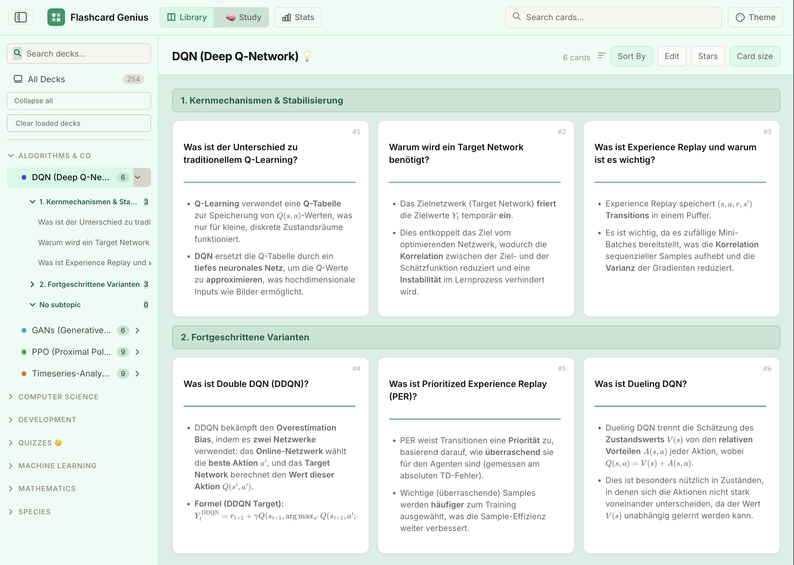
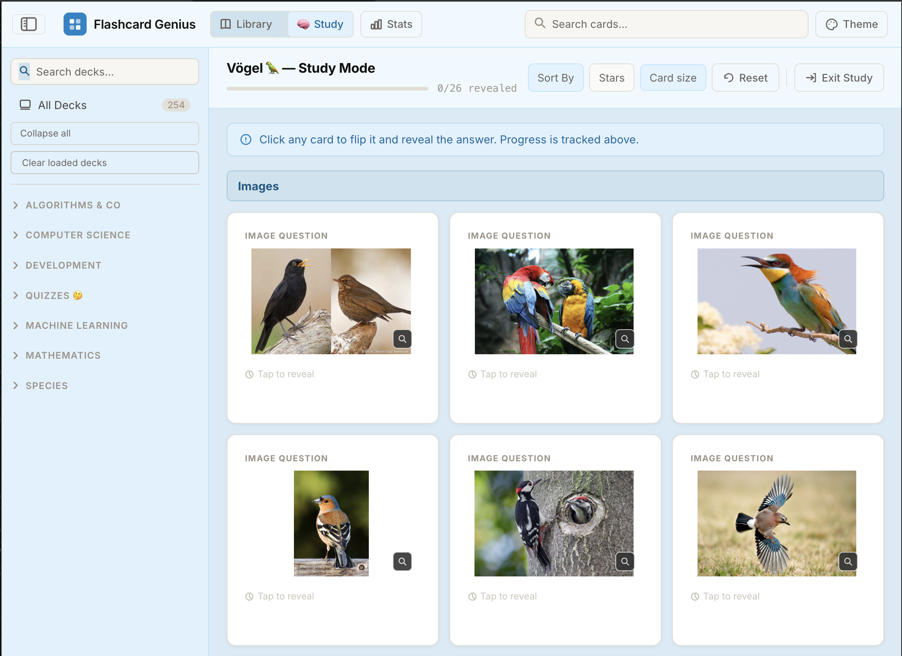
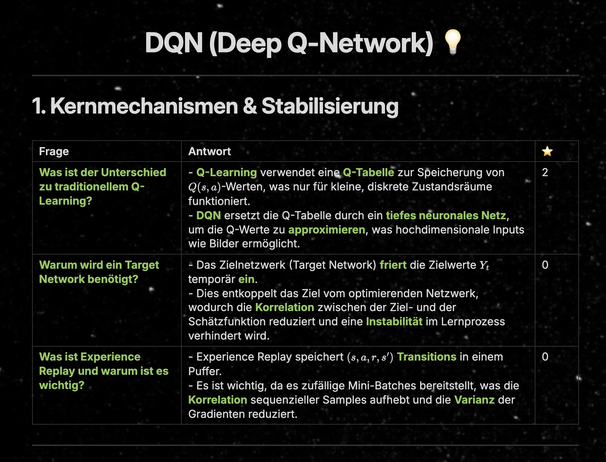

# Flashcard Genius for Obsidian 🧞‍♂️

Flashcard Genius is an offline-first Obsidian plugin for browsing, studying, and analysing Markdown flashcards. Every card remains a normal Markdown table in your vault. Nothing has to be imported into a separate database or uploaded to a service.

Flashcard Genius is an independent community plugin and is not affiliated with or endorsed by Obsidian.

- - -

## ✨ Why use it?

- See an entire deck at once instead of one card at a time.
- Choose your own order and keep working around a difficult card.
- Organise cards into topic blocks with `##` headings.
- Edit the source Markdown and see the changes reflected in the plugin immediately.
- Keep your notes, cards, and ratings under your control in the vault.
- Use it offline: Flashcard Genius does not initiate network requests.

- - -

## 🖼️ Screenshots

### Library

The Library shows all cards in a deck, grouped by topic. Click a card to select it. **Edit** opens its Markdown source in an adjacent pane, keeping the plugin and note visible together.



### Study mode

Study mode shows the question first. Click a card to select and flip it; click again or press **Space** to flip the selected card back. Image questions stay on the front; the back contains the answer text without repeating the question image.



### Markdown source format

Cards are authored as Markdown tables. The example below is the basis of the shown rendered version in the first reference image above.



- - -

## 📥 Manual Installation
Download and install the plugin directly in Obsidian, or follow these steps:
1. Build the plugin locally (see [Development](#development)).
2. Copy `dist/main.js`, `dist/manifest.json`, and `dist/styles.css` into:

   ```text
   <your-vault>/.obsidian/plugins/flashcard-genius/
   ```

3. Reload Obsidian.
4. Enable **Flashcard Genius** under **Settings → Community plugins**.

The plugin opens as a normal Obsidian tab. You can also install the same three files from a verified plugin release when one is available.

- - -

## 🗂️ Loading decks and images

Flashcard Genius adds **Open in Flashcard Genius** to the Obsidian file-menu.

- Right-click one Markdown file to load one deck.
- Right-click a folder to load all valid Markdown decks below it.
- Repeat the action on additional files or folders to append multiple decks to the same tab.
- Right-click a folder containing only supported image files (`png`, `jpg`, `jpeg`, `gif`, `webp`, `svg`, `avif`, or `bmp`) to create an image quiz.

For an image quiz, use the image filename as the card name, the filename becomes the question shown on the answer side. Keep the image-quiz folder free of Markdown files and unrelated assets; folders containing Markdown are treated as Markdown-deck folders instead. Folder names determine the generated deck grouping.

You can also use the command palette command **Open current note in Flashcard Genius** or configure a default folder in the plugin settings.

- - -

## 📝 Markdown deck format

Each deck needs an H1 title, optional H2 topic headings, and one or more tables. The first column always contains the question. A difficulty column is optional and is recognised only when the **last column's header** is `⭐`, `★`, `*`, `Sterne`, `Stars`, `Schwierigkeit`, `Difficulty`, or the existing `Rating` name. Matching ignores case, surrounding whitespace, and emoji presentation variants such as `⭐️`. All other column names are arbitrary. Numbers in answer cells never identify a difficulty column.

With a recognised final difficulty column, the columns between question and difficulty form the answer. Ratings from `1` to `5` work as before; empty or invalid ratings default to `0`. Without that header, **every column after the first contributes to the answer**, including the last one. Such cards have disabled rating controls and are treated as unrated (`0`) for sorting, statistics, and filtering. Star actions never change their Markdown or add a column. Import and export preserve whether a card has a difficulty column. Both formats can appear in the same deck, including under the same topic heading.

Answer columns retain their order and are combined with blank lines; empty answer cells are skipped. Questions can contain Markdown images or Obsidian wiki images such as `![[bird.webp]]`. **Card size → Font size** adjusts answer text using the same manual scale for text and image cards.

Answers in Library and Study use the same compact `CardAnswer` renderer for image and text cards. Each original non-empty answer column remains a separate part: a stronger theme-coloured divider follows the first part, with slightly thicker, more visible secondary dividers between later parts. Divider weights and responsive gaps come from shared CSS tokens. Spacing around dividers and Markdown paragraphs is compact. Paragraphs, line breaks, italics and formulas inside a column remain intact and never create extra dividers. Image answers use one fitted primary font: each following column uses 75% of the actual rendered size of the previous column. Text-card answers use 75% of the fitted question font. The manual font control is applied once, before fitting; widening a text card does not increase its preferred font size. Study backs do not repeat the front image. Front images fill their available frame as far as their aspect ratio permits, including upscaling small images, while retaining the existing card proportions and height limits without cropping or distortion.

Only Library image-card answers use a two-stage layout. The first non-empty answer column fills the remaining initial viewport; all later columns start completely below its visible edge. Selecting the card enables scrolling through the same single content viewport to reach them. Selection changes, resizing/resetting the card and reopening the view start at the top. A single answer column does not create an artificial extra scroll area. Study keeps its usual reveal and scrolling behavior. The **Edit** toolbar button is available in both Library and Study and opens the source Markdown beside the plugin view.

Text questions wrap between words and shrink to fit the available width and height in Library and Study. Automatic fitting stops at 10 px (or a smaller size explicitly chosen with the font control). Extremely long questions or unbreakable words can exceed this readable limit: an explicit **Read full question** button opens the complete Markdown question in a dialog, instead of silently hiding the rest or adding question-side scrolling. Essay-like image answers retain natural scrolling rather than shrinking whole paragraphs to an unreadable size.

For example, `| ![[Blauer-Drache.webp]] | Blauer Drache | *Glaucus atlanticus* | Meeresschnecke | 3 |` under the headers `Frage`, `Deutsch`, `Latein`, `Zusatzinfo`, `Sterne` displays “Blauer Drache”, a divider, then “Glaucus atlanticus”, a thinner divider, and “Meeresschnecke”. The star value remains separate from the answer. Source Markdown and stored column data are unchanged.

```markdown
# Neural Networks 💡

## Foundations

| Question | Answer | ⭐ |
| --- | --- | --- |
| What is a target network? | A periodically updated network used to stabilise training. | 2 |
| What does `Q(s, a)` represent? | The expected value of taking action `a` in state `s`. | 0 |

## Advanced topics

| Question | Answer | ⭐ |
| --- | --- | --- |
| What is experience replay? | A buffer that stores transitions for later training. | 3 |

## Cards without ratings

| Question | Answer | Additional information |
| --- | --- | --- |
| What is experience replay? | A buffer that stores transitions. | Transitions are sampled for training. |
| How many examples are in this batch? | Batch size | 5 |

| Question | Answer |
| --- | --- |
| What is a target network? | A periodically updated network. |
```

In the tables without ratings, “Additional information” and the numeric `5` remain answer content. Existing two-column tables and the older heading-based card format are also supported without ratings.

Use normal Markdown in the cells: paragraphs, lists, emphasis, links, images, and mathematical notation rendered by Obsidian's Markdown renderer. Escape a literal pipe inside a cell as `\|`. Use `<br>` when you need a deliberate line break inside one table cell.

- - -

## 🧭 The three main views

### Library

Library is the source-aware overview of your loaded files. It renders every card, keeps topic groups visible, and lets you choose the order in which you work.

Click a Library card or a question in the left Finder to select it. A Study-card click selects and flips that card; repeated clicks flip it back and forth. The single selected card and Finder entry share a subtle highlight in the current theme. Selection stays synchronised between Finder, Library and Study. Arrow navigation and Finder selection preserve revealed answers independently. Image zoom and rating buttons never flip the card.

**Edit** is a direct action: it opens the selected card's original Markdown note beside the plugin. A sibling Markdown pane is reused when available; otherwise the Workspace API creates a vertical split next to the plugin's own pane. The plugin stays visible, and other tabs in its pane are never used as the target. Without a selected card, it uses the current deck's source only when that source is unambiguous. If several files are possible, select a card first. The button has no active state or separate Edit mode, and cards have no edit icon. Library card clicks continue to select cards. Vault changes reload automatically.

For Markdown cards with a recognised final difficulty header, difficulty stars are written back to the matching final difficulty cell, which must exist. For decks without a difficulty column, the **Stars** toolbar button is greyed out and disabled. Hover over it or focus it with the keyboard for a short hint: name the last column `⭐`, `*`, or `Difficulty`. In mixed decks the button remains available, and cards without a difficulty column keep disabled rating controls.

Image-deck cards do not support editing or stars in the plugin controls because they are generated directly from image files.

### Study mode

Study mode presents the front/question first. Click a card to select and flip it. Click the same card again, or press **Space**, to flip it back. The flip transition is shorter (0.38 seconds), and reduced-motion preferences disable it. The toolbar lets you choose the number of cards per row and card height. The layout also adapts automatically to the available window width, including narrow iPhone and iPad layouts.

Only the selected card scrolls internally when its content is long. Wheel, trackpad and touch gestures over other cards scroll the surrounding card grid. Changing selection resets internal scroll positions; this does not change which answers are revealed.

With a card selected, **Left/Right** select the previous/next displayed card. **Up/Down** move between grid rows using the current column count, filters and sort order. In Study, **1–5** assign the selected card's difficulty through the existing star persistence; cards without a writable rating column cannot save ratings. Space has no action in Library. Shortcuts apply only inside the Flashcard Genius view and are ignored in inputs, editors and dialogs.

### Stats mode

Stats shows how many cards each deck contains at every difficulty level. Select a deck or difficulty slice to filter the card list, read the matching questions and answers, and start a study session with the filtered set.

- - -

## 🎨 Themes and responsive layout

Choose from the available colour themes in the top bar. The interface adapts its card grid, sidebar, and controls to the available width. Obsidian's interface, text, and monospace font variables are used so the plugin follows your vault's typography.

- - -

## 🔒 Offline and privacy

Flashcard Genius works locally inside your Obsidian vault.

```text
Flashcard Genius does not initiate network requests and does not transmit
notes, flashcards, settings, or usage data to external services.

The plugin does not use telemetry, analytics, remote fonts, update checks,
advertising, or external APIs.
```

Markdown files and local image assets are read through Obsidian's Vault APIs. Settings are stored through Obsidian's plugin data storage. The plugin does not require an account or API key. Documentation links in this README are ordinary links; if you open one manually, Obsidian or your operating system may handle it.

- - -

## 🛠️ Development

This repository is the canonical source for plugin development and community releases. The previous `Storm-131/Flashcard_Genius` repository is a historical reference; new changes belong here. The plugin source is in `src/`, with local npm workspaces in `packages/core/` and `packages/ui/`. The browser preview in `web/` exercises the same UI component as Obsidian.

Requirements: Node.js 24 or newer and npm (`.nvmrc` selects Node 24).

```bash
npm ci
npm run build
```

The production build creates exactly `dist/main.js`, `dist/manifest.json`, and `dist/styles.css`. Generated builds are ignored by Git; the release workflow builds them from the tagged source.

Available checks and preview:

```bash
npm test
npm run typecheck
npm run typecheck:web
npx playwright install chromium
npm run release:verify
npm run dev:preview
```

Patch version **1.0.3 is prepared locally** for the Obsidian review fixes. Do not run `release:prepare -- patch` again for this patch: that would prepare 1.0.4. For subsequent versions, `npm run release:prepare -- patch` updates the manifest, compatibility history, workspace versions and lockfile locally without Git operations.

The tag-triggered GitHub Actions workflow validates the exact version and repository, runs all tests and production builds, then publishes the three plugin assets. It refuses to replace an existing release. Tags use the exact version without a `v` prefix.

See [the 1.0.3 review notes](docs/review-1.0.3.md) for the fixes and remaining lint warnings, and [the migration and release guide](docs/migration-1.0.2.md) for local Obsidian testing, validation results and the manual publication steps after approval.

- - -

## 📄 License

Flashcard Genius is licensed under the [MIT License](LICENSE). Third-party notices are listed in [THIRD_PARTY_NOTICES.md](THIRD_PARTY_NOTICES.md).
